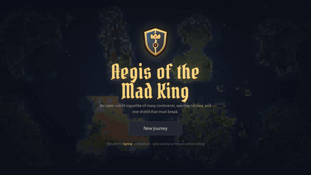
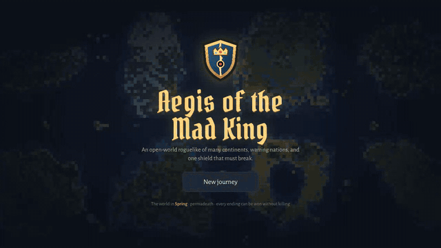
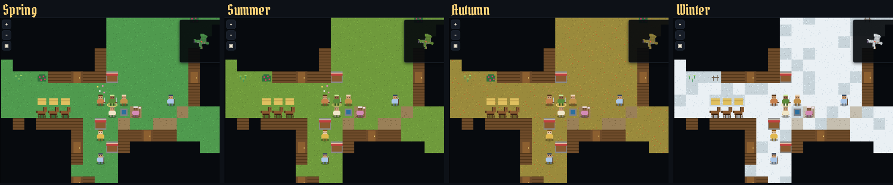
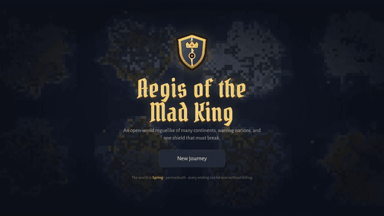
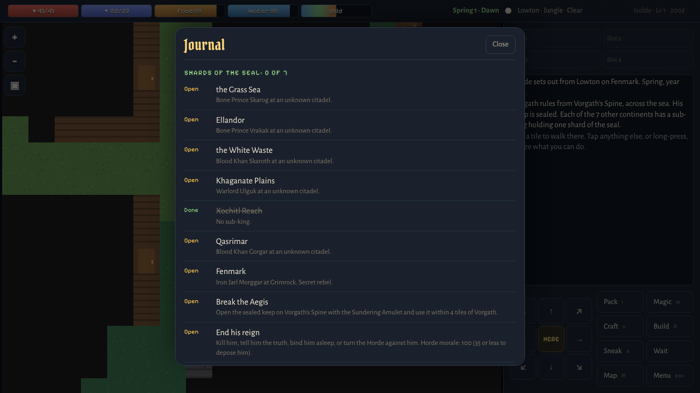
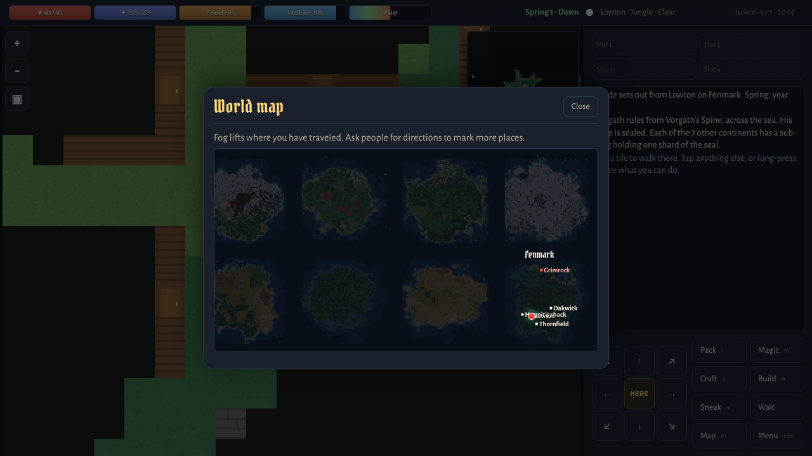

<p align="center"></p>
<h1 align="center">Aegis of the Mad King</h1>
<p align="center"><b>An open-world roguelike of many continents, warring nations, and one shield that must break.</b><br>
Turn-based · permadeath · plays on phone, tablet, and desktop · works offline · every ending can be won without killing</p>

<p align="center"></p>

Vorgath the Mad King rules from a sealed keep on his own continent. An amulet called the Aegis makes him untouchable. Every other continent has a **sub-king**, and each sub-king holds one shard of the seal. Cross the ocean, win every shard however you like, and break the Aegis. Then kill Vorgath, tell him the truth, bind him asleep, or turn his Horde against him.

The world doesn't wait for you. Armies march along real roads and lay siege to towns. Nations counter-attack, caravans trade, herds migrate, pirates raid the coast, plagues spread from village to village, and vampires hunt on moonless nights.

## Play

- **Web (phone or desktop):** open `index.html`, or play the GitHub Pages build at `https://ishmamhaque1112.github.io/aegis-of-the-mad-king/`. On first visit it installs as an offline app (PWA). On a phone, use *Add to Home Screen*.
- **Desktop app (Windows, macOS, Linux):** run the **Desktop builds** workflow in GitHub Actions, or build locally with `cd desktop && npm install && npm run dist`.
- **Android app:** run the **Android APK** workflow, or build locally with `cd mobile && npm install && npm run android`, then open `mobile/android` in Android Studio. For iOS, run `npm run ios` on a Mac.

**Controls:** Tap a far tile to walk there. Tap anything to see what you can do with it. Long-press or right-click shows every option.

On a keyboard:
- Move with the arrows, numpad, or `hjklyubn`.
- `Space` acts on your own tile, and `.` waits.
- `i` pack, `m` magic, `c` craft, `B` build, `s` sneak, `M` map, `J` journal, `C` character, `L` legends, `F` fish.
- `+`/`-` zoom, and `1`–`9` pick dialogue options.

## A living world

<p align="center"></p>

- **Real armies on real roads.** The Mad King's warbands, nation patrols, and armies travel the road network. Far from you they fight in the abstract; close to you they become creatures you can see, join, or flee. Some soldiers ride horses, wolves, camels, war elephants, or mammoths.
- **Sieges and conquest.** Villages can be overrun, retaken, and liberated. A nation that besieges a sub-king's citadel can bring him down without you.
- **Nations** each have a capital, a ruler, a government form, and a national trait, such as seafaring, devout, or mercantile. Each nation tracks your reputation separately. On the Vast and Colossal scales, capitals grow into massive walled cities.
- **Horde settlements** have their own villages, forts, havens, schedules, loot, and garrisons.
- **Creatures follow abstract simulation.** Inspired by Rain World, they keep living when you're not looking. They remember you, hunt, eat, flee, sleep, and smell you on the wind, as in UnReal World. Noise draws bands toward you, as in Cataclysm: DDA.
- **Every village has a history.** Like Dwarf Fortress's legends mode, each world has up to 500 years of generated history. Villages have their own founding stories, customs, and taboos, in the spirit of Caves of Qud. Everything you hear under *What news?* actually happened.

<p align="center"></p>

## Sub-kings and shards

Each sub-king has one of ten weaknesses: pride, greed, paranoia, faith, starvation, cowardice, scholarship, drink, sickness, or secret rebellion. Locals hint at it if you ask about the Horde. You can win his shard several ways:
- Out-drink him, win a duel, or solve his riddles.
- Cure his plague, feed his starving garrison, or forge orders that turn his captains against him.
- Rally a nation to besiege him.
- Or just kill him.

## The sea

<p align="center"></p>

- **Ships:** build a raft, or buy a longship from a shipwright. Stock its hold with supplies, crew it with hired sellswords, and fit cannons. Wind changes how fast you sail.
- **Hazards:** Horde pirate ships and rafts carry cannons. Sharks, sea serpents, and krakens attack everyone. If your ship goes down, you may haul yourself onto a raft lashed from the wreckage.
- **Other travel:** fish with rods, nets, and harpoons, or book passage on a ferry between ports.

## Vehicles

<p align="center"></p>

There are 24 vehicles, and anyone can drive them: you, your companions, villagers, merchants, soldiers, pirates, and the Horde.

| | Vehicles |
|---|---|
| **Wheels** | Handcart, covered wagon, war chariot, Horde scythed chariot, armored war wagon (musket volleys), bombard cart, field ballista, catapult, battering ram |
| **Snow, ice, and sand** | Dog sled, ice yacht, sand skiff |
| **Precursor machines** | Clockwork strider (walks through forests and shallows, fires a sun-beam) and solar crawler. Both run on sunlight. |
| **Water** | Canoe, rowboat, raft, longship, river barge, merchant cog, war galley (rowed, with a bronze ram), pirate sloop, war galleon |
| **Air** | Hot-air balloon (burns firewood, drifts with the wind) and rune skiff (burns arcane dust) |

How they work:
- **Power:** wagons and chariots need a draft animal. Ride up on your horse to hitch it, or hitch a tame ox, camel, or elephant. Sails follow the wind, galleys row faster with more crew, solar machines recharge in daylight, and flyers burn fuel.
- **Getting one:** buy from stablemasters, shipwrights, smiths, artificers, witches, nomads, and islanders, or build one yourself.
- **Fighting with them:** chariots run people down, war wagons fire volleys, rams smash gates, catapults lob stones over walls, and vehicles soak up hits aimed at their riders.
- **NPC drivers:**
  - Nation armies roll out war wagons, bombards, and chariots, and Horde warbands bring scythed chariots, catapults, and rams.
  - Caravans travel in wagons, and fisherfolk row out by day.
  - Frightened or hostile NPCs grab an unattended vehicle, including yours, and drive off in it.
  - You can steal theirs, or hand the reins to a companion.

## Battle magic

Every army has casters with their own spellsets:
- **Nations:** war wizards (fireball, frost, ward) and battle chaplains (heal, bless, ward, fear). Northern forces field rune-casters.
- **The Horde:** warlocks (fireball, hex, fear, raise dead), war-mages, and bone-shamans.
- **Others:** bandit hedge mages (sleep, blink, charm, gust), pirate storm-callers, dune seers, and island sea witches.

Casters ward wounded allies and bless the battle line. The new spells (Fireball, Ward, Battle Blessing, Hex) can also be learned from scrolls.

## Oceans, islands, and archipelagos

<p align="center"></p>

- **Archipelagos:** island chains fill the seas between continents, and empty ocean regions become great archipelagos. Each has a theme: tropical isles, coral atolls with lagoons, green isles, frozen skerries, smoking fire isles, sun-bleached cays, or mist isles of crystal and fungus.
- **Island sites:** islander fishing villages, pirate coves, lighthouses, shipwrecks guarded by giant crabs and drowned sailors, castaways to rescue, sea witches, merfolk lagoons, roc and harpy rookeries, ruins, shrines, and smuggler camps.
- **Island wildlife:** sea turtles, dragon lizards, coconut crabs, penguins, walruses, and marine iguanas.
- **At sea:** dolphins, whales, manta rays, sea snakes, and jellyfish blooms.
- **Mapping:** lighthouse keepers and islanders mark nearby islands and wrecks on your map.

## The world map

Choose between 6 and 10 continents, at Standard, Vast (2.25× area), or Colossal (4× area) scale. Each continent takes one of nine shapes: broad, long, twin-lobed, crescent around a great bay, star of peninsulas, ring around an inland sea, shattered into islands, fjord-cut, or a narrow mountain spine. Horde forts and bandit camps keep well away from the towns they threaten, though vassal nations live in their shadow. You can also tune sea level, climate, rainfall, rivers, islands, nations, Horde strength, monsters, wildlife, ruins, and history length. Use a seed or today's daily seed.

<p align="center"></p>

The world has 26 biomes: Deep Ocean, Open Sea, Coral Shoals, Beach, Meadowland, Oakwood, Birchwood, Old Darkwood, Jungle, Bamboo Thicket, Mangrove, Swamp, Savanna, Steppe, Desert, Red Badlands, Salt Flats, Tundra, Taiga, Glacier, Mountains, Heather Highlands, Ashlands, Fungal Forest, Blossom Vale, and Crystal Barrens.

## Seasons, days, and moons

<p align="center"></p>

- **Days:** a full day is 360 turns long and a season lasts 6 days. Snow buries fields, rivers freeze into roads, and armies stay home in winter.
- **The moon** follows an 8-day cycle:
  - Full moons bring out wolves and werewolves.
  - New moons are pitch black, when thieves and vampires hunt.
  - Blood moons raise the dead.
  - Rare eclipses darken midday.

<p align="center"></p>

## Body, sickness, and strange fates

- **Survival:** manage hunger, thirst, temperature, swimming, and drowning.
- **23 diseases**, including Black Boil, Lockjaw, Rabies, Lung-rot, Brain Fever, Crystal Blight, and the Grey Walk:
  - Each spreads its own way: bites, water, air, wounds, or contact.
  - Each has silent incubation, visible symptoms, and a cure. Healers can diagnose you.
- **Vampirism:** you get night vision and strength, but you must feed on sleeping people and burn in daylight. Vampire nobles keep thralls, and an infected victim can spread the curse. It is curable.
- **Solar cyborg augments:** an artificer in a precursor vault can install arms, legs, eyes, skin, a core, an arm cannon, a neural lace, or a cloak. They make you far stronger, but they run on sunlight.

## Alchemy

All 26 reagents carry four hidden properties out of 24, reshuffled in every world, much like Skyrim and NetHack's unidentified potions:
- Taste reagents to learn their properties.
- Brew two or three together, and the properties they share become the potion.
- Found potions are unidentified. Drink them, throw them, coat a weapon, mix two (carefully), or pay a healer to identify them.

<p align="center"> </p>

## Tabletop at heart

- **d20 checks:** risky actions roll a d20 against a difficulty and show the roll in your log. Heroic moments grant inspiration, which rerolls your next failure.
- **Reactions and morale:** creatures roll 2d6 to react when they first meet you. Wounded and leaderless enemies may break and flee, or surrender.
- **Backgrounds:** soldier, noble, outlander, sailor, acolyte, criminal, sage, folk hero, or hermit, on top of 9 classes.

## Also in the box

- 167 creature and NPC types, 154 items, 59 recipes, 10 mounts, and 24 vehicles.
- Morrowind-style spell invention: combine up to 4 of 27 effects.
- Enchanted forging, farming, building shelters, and buying an empty house in any village.
- Hiring sellswords, taming pets, and procedural pixel art throughout.
- **Procedural music and sound.** All audio is synthesized live with the Web Audio API, so no audio files ship with the game and everything is copyright-free by construction.
  - The music shifts by biome, time of day, danger, town, and moon phase.
  - Sound effects respond to steps, hits, gunfire, explosions, splashes, spells, coins, howls, and thunder.

<p align="center"> </p>

▶️ **Full recorded playthrough:** [docs/media/playthrough.mp4](docs/media/playthrough.mp4). Playtest notes and known issues are in [docs/PLAYTEST.md](docs/PLAYTEST.md).

## Develop

The game is plain JavaScript with no dependencies, in `src/00_core.js` through `src/18_ui.js`, plus the `head.html` shell. `./build.sh` bundles everything into the single-file `index.html`.

```bash
./build.sh                      # rebuild index.html
node tests/smoke.js seed1,seed2 # browser fuzz test (requires playwright)
```

The original hackathon version (one continent, three shards) lives in [`classic/`](classic/).

## Inspirations and credits

This is an original game, written from scratch. It borrows ideas, not code or assets, from:
- **Roguelikes:** Shattered Pixel Dungeon (creature states, clean mobile UI), NetHack (unidentified potions, emergent interactions), and Pathos.
- **Survival and simulation:** Cataclysm: DDA (noise, survival), Dwarf Fortress (generated history and legends), UnReal World (wind, scent, hunting), Caves of Qud (village lore, factions), and Rain World (off-screen creature simulation).
- **Tabletop:** D&D, from the d20 checks and inspiration of the 5e SRD, and OSR games, from 2d6 reactions and morale.

Note that Dwarf Fortress itself is closed source; its community tools DFHack and df-structures are open.

- **Fonts:** Pirata One, Alegreya Sans, and Pixelify Sans, under the SIL Open Font License, bundled in `fonts/`.
- **Art and audio:** all generated procedurally in code.
