<p align="center"></p>
<h1 align="center">Aegis of the Mad King</h1>
<p align="center"><b>An open-world roguelike of many continents, warring nations, and one shield that must break.</b><br>
Turn-based · permadeath · plays on phone, tablet, and desktop · works offline · every ending can be won without killing</p>

<p align="center">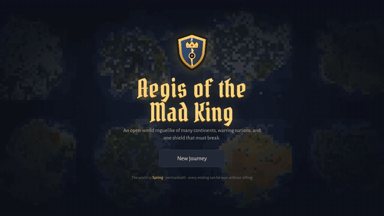</p>

Vorgath the Mad King rules from a sealed keep on his own continent. An amulet called the Aegis makes him untouchable. Every other continent has a **sub-king**, and each sub-king holds one shard of the seal. Cross the ocean, win every shard however you like, and break the Aegis. Then kill Vorgath, tell him the truth, bind him asleep, or turn his Horde against him.

The world doesn't wait for you. Armies march along real roads and lay siege to towns. Nations counter-attack, caravans trade, herds migrate, pirates raid the coast, plagues spread from village to village, and vampires hunt on moonless nights.

## Play

- **Web (phone or desktop):** open `index.html`, or play the GitHub Pages build at `https://ishmamhaque1112.github.io/aegis-of-the-mad-king/`. On first visit it installs as an offline app (PWA). On a phone, use *Add to Home Screen*.
- **Desktop app (Windows, macOS, Linux):** run the **Desktop builds** workflow in GitHub Actions, or build locally with `cd desktop && npm install && npm run dist`.
- **Android app:** run the **Android APK** workflow, or build locally with `cd mobile && npm install && npm run android`, then open `mobile/android` in Android Studio. For iOS, run `npm run ios` on a Mac.

**Controls:** Tap a far tile to walk there. Tap anything to see what you can do with it. Long-press or right-click shows every option.

On a keyboard:
- Move with the arrows, numpad, or `hjklyubn`.
- `Space` acts on your own tile, and `.` waits.
- `i` pack, `m` magic, `c` craft, `B` build, `s` sneak, `M` map, `J` journal, `C` character, `L` legends, `F` fish.
- `+`/`-` zoom, and `1`–`9` pick dialogue options.

## A living world

<p align="center">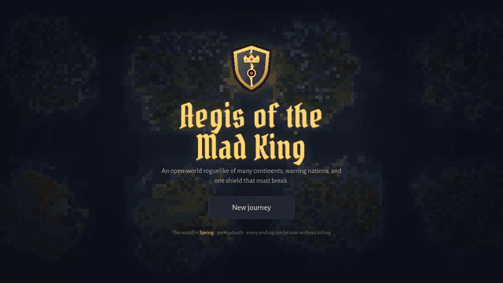</p>

- **Real armies on real roads.** The Mad King's warbands, nation patrols, and armies travel the road network. Far from you they fight in the abstract; close to you they become creatures you can see, join, or flee. Some soldiers ride horses, wolves, camels, war elephants, or mammoths.
- **Sieges and conquest.** Villages can be overrun, retaken, and liberated. A nation that besieges a sub-king's citadel can bring him down without you.
- **Nations** each have a capital, a ruler, a government form, and a national trait, such as seafaring, devout, or mercantile. Each nation tracks your reputation separately. On the Vast and Colossal scales, capitals grow into massive walled cities.
- **Horde settlements** have their own villages, forts, havens, schedules, loot, and garrisons.
- **Creatures follow abstract simulation.** Inspired by Rain World, they keep living when you're not looking. They remember you, hunt, eat, flee, sleep, and smell you on the wind, as in UnReal World. Noise draws bands toward you, as in Cataclysm: DDA.
- **Every village has a history.** Like Dwarf Fortress's legends mode, each world has up to 500 years of generated history. Villages have their own founding stories, customs, and taboos, in the spirit of Caves of Qud. Everything you hear under *What news?* actually happened.

<p align="center">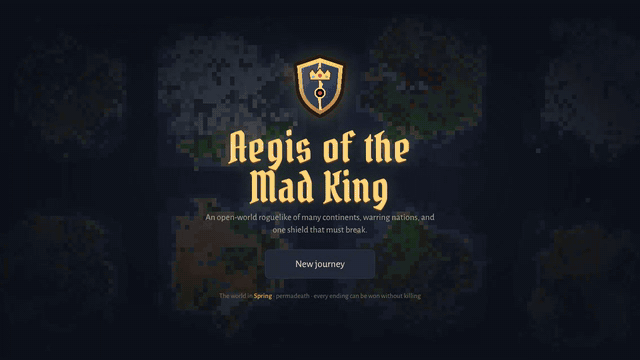</p>

## Sub-kings and shards

Each sub-king has one of ten weaknesses: pride, greed, paranoia, faith, starvation, cowardice, scholarship, drink, sickness, or secret rebellion. Locals hint at it if you ask about the Horde. You can win his shard several ways:
- Out-drink him, win a duel, or solve his riddles.
- Cure his plague, feed his starving garrison, or forge orders that turn his captains against him.
- Rally a nation to besiege him.
- Or just kill him.

## The sea

<p align="center">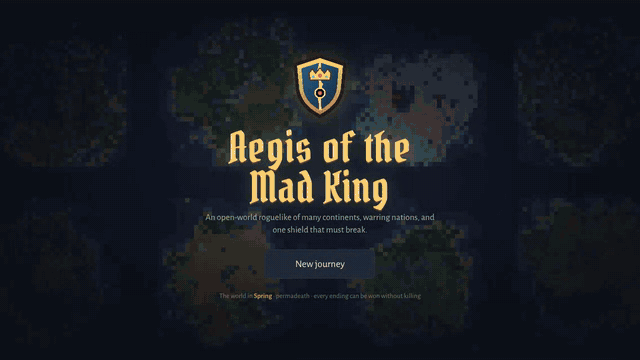</p>

- **Ships:** build a raft, or buy a longship from a shipwright. Stock its hold with supplies, crew it with hired sellswords, and fit cannons. Wind changes how fast you sail.
- **Hazards:** Horde pirate ships and rafts carry cannons. Sharks, sea serpents, and krakens attack everyone. If your ship goes down, you may haul yourself onto a raft lashed from the wreckage.
- **Other travel:** fish with rods, nets, and harpoons, or book passage on a ferry between ports.

## Vehicles

<p align="center"></p>

There are 24 vehicles, and anyone can drive them: you, your companions, villagers, merchants, soldiers, pirates, and the Horde.

| | Vehicles |
|---|---|
| **Wheels** | Handcart, covered wagon, war chariot, Horde scythed chariot, armored war wagon (musket volleys), bombard cart, field ballista, catapult, battering ram |
| **Snow, ice, and sand** | Dog sled, ice yacht, sand skiff |
| **Precursor machines** | Clockwork strider (walks through forests and shallows, fires a sun-beam) and solar crawler. Both run on sunlight. |
| **Water** | Canoe, rowboat, raft, longship, river barge, merchant cog, war galley (rowed, with a bronze ram), pirate sloop, war galleon |
| **Air** | Hot-air balloon (burns firewood, drifts with the wind) and rune skiff (burns arcane dust) |

How they work:
- **Power:** wagons and chariots need a draft animal. Ride up on your horse to hitch it, or hitch a tame ox, camel, or elephant. Sails follow the wind, galleys row faster with more crew, solar machines recharge in daylight, and flyers burn fuel.
- **Getting one:** buy from stablemasters, shipwrights, smiths, artificers, witches, nomads, and islanders, or build one yourself.
- **Fighting with them:** chariots run people down, war wagons fire volleys, rams smash gates, catapults lob stones over walls, and vehicles soak up hits aimed at their riders.
- **NPC drivers:**
  - Nation armies roll out war wagons, bombards, and chariots, and Horde warbands bring scythed chariots, catapults, and rams.
  - Caravans travel in wagons, and fisherfolk row out by day.
  - Frightened or hostile NPCs grab an unattended vehicle, including yours, and drive off in it.
  - You can steal theirs, or hand the reins to a companion.

## Creatures that think

<p align="center">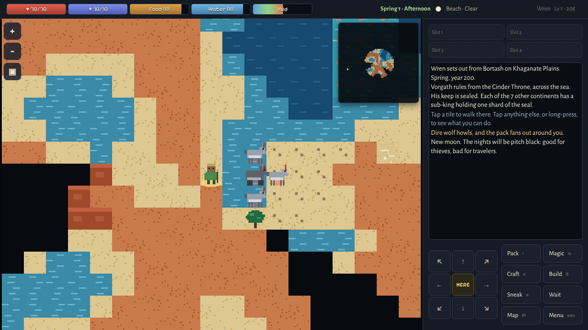</p>

Every creature has a fighting style that suits it:

| Type | How it fights |
|---|---|
| **Packs** (wolves, hyenas, wargs, Horde hounds) | Follow an alpha, which howls to rally the pack. They spread out to surround you rather than queue up. A lone wolf stalks and waits. Kill the alpha and the pack may scatter. |
| **Ambushers** (jaguars, snow leopards, crocodiles, pythons, spiders, dragon lizards) | Hide and creep toward you, pounce from cover, then slink off to hide again when hurt. Hungry ones stalk travelers. |
| **Territorial beasts** (bears, boars, walruses, rhinos, giant crabs) | Warn you first: they roar, stamp, and show tusks. Back off and they let you go. Stay and they charge. |
| **Herds** | Panic spreads through the herd. Big herds stampede and trample anyone who corners them. |
| **Scavengers** (vultures, crows, gulls, rats) | Circle at a distance and wait for something to weaken or die. They flock to corpses. |
| **Fliers** (harpies, hawks, wyverns, rocs) | Swoop in, strike, and pull away. |
| **Brutes** | Giants, cyclopes, trolls, and yetis hurl boulders. Minotaurs charge in a straight line. |
| **Sharks** | Circle a swimmer before biting, unless they smell blood. |
| **The dead** | Never give up a chase. Zombies drift together into hordes, wraiths sense the living through walls, and ghouls eat the dead to heal. |
| **Soldiers** | Shout for help, guard their casters, and finish off the most wounded enemy. |
| **Musketeers, archers, and casters** | Back away to keep their range, and retreat behind allies to reload or recover mana. |
| **Berserkers** | Fly into a blood rage when wounded. |
| **Assassins** | Strike from the shadows, then vanish again. |
| **Civilians** | Scream for the guard, who come running, and flee toward them. |

### Leaders and commanders
- **In battle:** pack alphas, band captains, and garrison leaders give orders. They pick a target for everyone to focus on, rally anyone who is breaking ("Hold the line!"), and sound the retreat when the fight is lost. If a leader falls, the next strongest takes over, though followers may break and run first.
- **Nobles and rulers:** they raise the alarm and have their guards close around them as bodyguards. Sub-kings and Vorgath call every guard in the hall.
- **Across the map:**
  - **Sub-kings** send warbands to relieve besieged Horde forts, reinforce their own sieges, and put a price on your head once you've killed enough of their soldiers or carry shards. Their hunters track you across the continent.
  - **Nation rulers** send armies to break sieges of their towns, march to retake captured ones, and post bounties on outlaws.
  - **Vorgath** sends his elite Hunters after you once you hold half the shards.

## Battle magic

Every army has casters with their own spellsets:
- **Nations:** war wizards (fireball, frost, ward) and battle chaplains (heal, bless, ward, fear). Northern forces field rune-casters.
- **The Horde:** warlocks (fireball, hex, fear, raise dead), war-mages, and bone-shamans.
- **Others:** bandit hedge mages (sleep, blink, charm, gust), pirate storm-callers, dune seers, and island sea witches.

Casters ward wounded allies and bless the battle line. The new spells (Fireball, Ward, Battle Blessing, Hex) can also be learned from scrolls.

## Oceans, islands, and archipelagos

<p align="center"></p>

- **Archipelagos:** island chains fill the seas between continents, and empty ocean regions become great archipelagos. Each has a theme: tropical isles, coral atolls with lagoons, green isles, frozen skerries, smoking fire isles, sun-bleached cays, or mist isles of crystal and fungus.
- **Island sites:** islander fishing villages, pirate coves, lighthouses, shipwrecks guarded by giant crabs and drowned sailors, castaways to rescue, sea witches, merfolk lagoons, roc and harpy rookeries, ruins, shrines, and smuggler camps.
- **Island wildlife:** sea turtles, dragon lizards, coconut crabs, penguins, walruses, and marine iguanas.
- **At sea:** dolphins, whales, manta rays, sea snakes, and jellyfish blooms.
- **Mapping:** lighthouse keepers and islanders mark nearby islands and wrecks on your map.

## The world map

The default **Earthlike** map looks like a real world map:
- **Continents** of very different sizes sit freely in a single world ocean. Each is built from overlapping tectonic plates, with peninsulas, mountain ranges along fold belts, and pack ice at both poles.
- **Climate** follows latitude: wet tropics at the equator, deserts around the subtropics, temperate belts, then boreal forest and tundra toward the poles.
- **Winds:** trade winds and westerlies throw rain shadows behind the mountains.
- **Islands:** island arcs line the coasts, hotspot chains trail across open ocean, and warm archipelagos scatter the tropics.

<p align="center">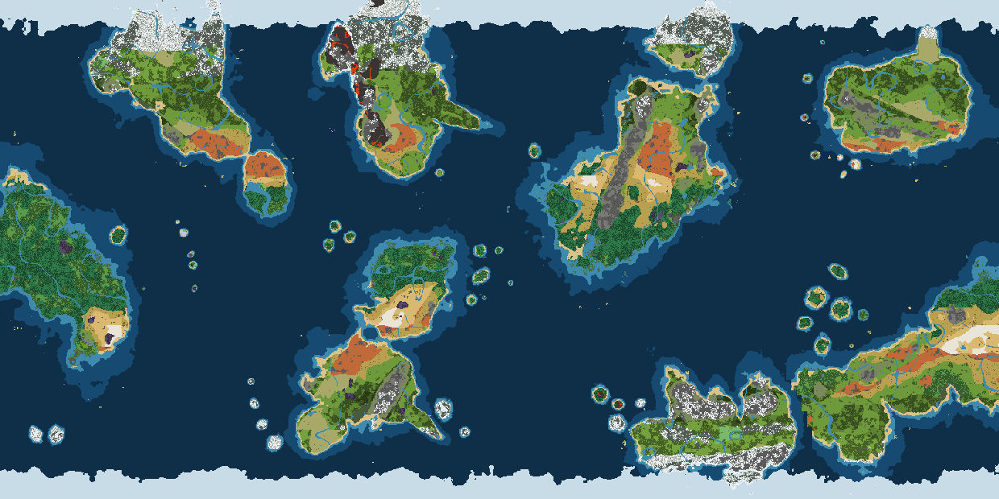</p>

Choose between 6 and 10 continents, at Standard, Vast (2.25× area), or Colossal (4× area) scale. The **Classic** style keeps the original layout of one continent per grid cell, where each continent takes one of nine shapes: broad, long, twin-lobed, crescent around a great bay, star of peninsulas, ring around an inland sea, shattered into islands, fjord-cut, or a narrow mountain spine. Horde forts and bandit camps keep well away from the towns they threaten, though vassal nations live in their shadow. You can also tune sea level, climate, rainfall, rivers, islands, nations, Horde strength, monsters, wildlife, ruins, and history length. Use a seed or today's daily seed.

<p align="center">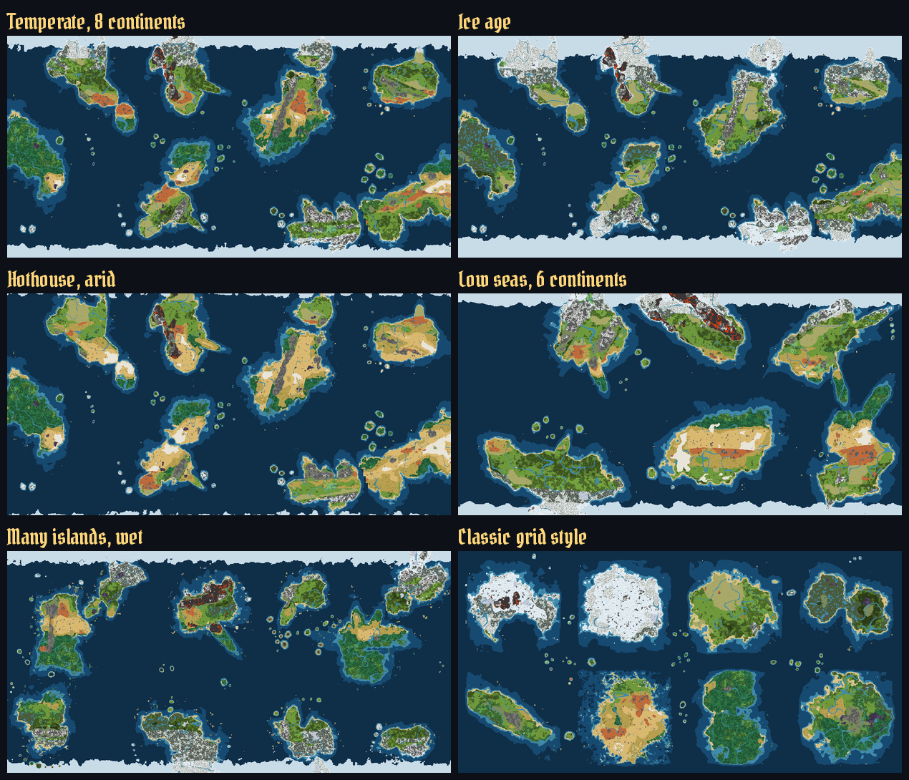</p>

The world has 26 biomes: Deep Ocean, Open Sea, Coral Shoals, Beach, Meadowland, Oakwood, Birchwood, Old Darkwood, Jungle, Bamboo Thicket, Mangrove, Swamp, Savanna, Steppe, Desert, Red Badlands, Salt Flats, Tundra, Taiga, Glacier, Mountains, Heather Highlands, Ashlands, Fungal Forest, Blossom Vale, and Crystal Barrens.

## Your character

Seven **attributes** (Strength, Agility, Endurance, Perception, Intellect, Will, Presence) on a 1 to 20 scale sit under **32 skills** in combat, magic, stealth, survival, craft, travel, and social groups. Skills improve by doing: swinging an axe trains Axes, haggling trains Trade, swimming trains Swimming. Each skill has a **potential** bar that drains as you practise and refills when you sleep or level up, so you can't grind one skill all night. Your class sets your starting attributes and **major skills**, and your background adds more.

At creation you pick **traits** on a 3-point budget: advantages such as Quick learner, Silver tongue, or Bane of the dead, paid for with disadvantages such as Frail, Sun-sick, or Wanted. Trainers teach skill lessons for coin.

The body matters too. **Stamina** drains when you fight, sprint, and swim, and you hit harder rested. Deep wounds **bleed** until bound. Heavy blows can **break an arm or leg**, which a healer or a Medicine check can set, and **pain** dulls your aim and wits.

<p align="center">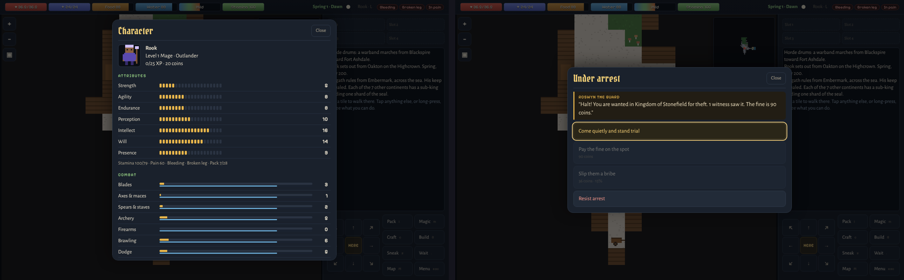</p>

## A society that remembers

- **People are records,** not spawns. Every townsperson has a birth year, values (honor, greed, piety, courage, kindness), a spouse, and children. They age, marry, have children, and die, and when a smith dies someone new takes up the trade.
- **Reputation is by group** (common folk, merchants, nobility, clergy, the underworld, and scholars) and spreads **by word of mouth.** A deed reaches the next town only when news could have travelled there, and takes days to cross the sea. Kill someone and their kin hold a grudge.
- **Rumors** travel at the speed of news, distort as they go, and are sometimes plain wrong.
- **Live history:** what you and others do becomes the world's history, which you can read in its legends.

## Trade, hunger, and winters

Every settlement keeps **stockpiles** of food, timber, ore, cloth, tools, medicine, and luxuries. Prices follow scarcity, and caravans really carry cargo between towns. A poor **harvest** means a hungry winter: prices soar, people starve, and **refugees** take to the roads looking for somewhere to settle. You can donate food, give alms, or profit from it.

Settlements **grow, shrink, and fall to ruin.** A town that empties becomes a ruin that bandits move into, and can be resettled later. Thriving towns **found new villages,** with roads to them.

## Rulers, law, and faith

- **Rulers** have goals (conquest, defense, wealth, faith, or paranoia) that shape what their nation does. They age, and when one dies an heir is crowned, or rival claimants start a **succession crisis** that you can tip by backing one of them.
- **Crime** is witnessed. Witnesses report you, your **bounty** rises in that nation, and guards come to arrest you. You can stand **trial** (argue your innocence, or bribe the magistrate), pay the fine, slip a bribe, or resist. Sentences mean jail time, fines, or banishment.
- **Six gods** with their own likes, taboos, and **holy days:** Ysolde of the Hearth (home and harvest), Kaurn the Stormfather (sea and courage), Morrow the Pale Ferryman (death), Thessa of the Green (beasts and forests), Vel the Lantern (knowledge and truth), and Ashgar the Unchained (freedom and rebellion). Pledge to one at an altar and build **piety** by doing what they love. Pious followers can call on miracles; breaking a taboo costs you.

## Guilds, rivals, and property

- **Five guilds** with ranks, perks, and timed quests: the Ironhand Lodge (fighters), the Circle of the Lantern (mages), the Quiet Hand (thieves), the Saltroad League (merchants), and the Order of the Dawnward (undead hunters). Rank needs both reputation and skill.
- **Rival adventurers** roam the world, clear dungeons, grow stronger, and may beat you to a sub-king's shard. Meet them on the road to trade stories, travel together, or buy a shard off them. The **Hall of Fame** ranks everyone.
- **Own a shop or a ranch.** Buy a deed from a town elder, stock the shelves or raise sheep and hens, and hire a clerk or hand to run it while you're away.

## Travel and wildlife

**Fast travel** asks how you want to go: cautious, normal, or reckless, sleeping at inns or camping. The journey runs into the bands that are really on the roads, which you can fight or sneak past.

Wildlife lives too. Animals keep **dens,** breed in spring, starve in hard winters, and thin out where you overhunt. Bears and others **hibernate** (and wake up angry if disturbed), and herds **migrate** between summer and winter ranges.

## Family, home and land

- **Farm in cycles.** Soil tires when you plant the same crop twice, recovers when left fallow, and comes back faster with manure from your ranch. Weeds choke yields, blight strikes in droughts, and ranch animals need hay to get through winter.
- **Court and marry.** Spend time with someone, bring gifts, and propose once they love you. Your spouse keeps a home, writes to you, and you may have children.
- **Your line goes on.** When you die, carry on as your spouse, a grown child or stepchild, or anyone you named as your heir. They inherit your coin, savings, property, half your fame (and half your bounties), and your weapon as an heirloom.
- **Found a settlement.** Buy a charter from a ruler, choose the land, and set taxes. Build a palisade, granary, shrine, inn or watchtower. Fed and fairly taxed settlers attract more settlers; overtaxed ones leave, and in the end throw you out.
- **Counting houses** in towns hold savings that earn interest and pass to your heir, and lend money that has to be paid back on time.
- **Taxes and tithes.** Rulers tax your property every season, more under greedy rulers or in wartime. Skip it and you're wanted. Tithe at an altar for piety.

## A world that talks

<p align="center">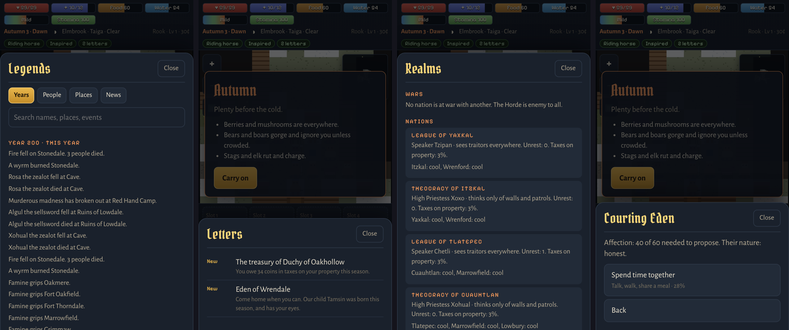</p>


- **Letters.** Write to people you've met. Couriers really walk the roads, so letters take time and bandits can take them. Replies bring news, thanks, or a few coins from friends. Officials write to you about taxes and debts.
- **Intercept the post.** Townsfolk send letters too. Rob a courier and you may find an affair to blackmail, a crown scandal to sell, a tip that grain prices are about to rise, or a buried cache that is really there.
- **News travels.** Every event spreads outward at the speed of travel. Ask town officials for word from other towns, or buy a broadsheet.
- **Books.** Write a memoir of your deeds, a history of the land, a guide to your best skill, or a slanderous pamphlet. Scholars copy and sell them, copies spread along the roads, and you earn royalties. Libraries sell chronicles that reveal places, bestiaries, and skill guides.
- **Prophecies come true.** Seers speak of a ruler's death, a famine, fire from the sky, a war, or a hero's rise, and the world really does it on schedule. Some can be stopped: catch the assassin, fill the granary, or talk the crowns out of war.
- **The Legends browser** searches the whole history by year, person or place, and now keeps what happened during play when you load a save.

## Realms at war

- **Nations go to war** with each other over border incidents and rulers' ambitions. Armies march on enemy towns, and borders really move. Long wars wear both sides down until one sues for peace, sometimes paying tribute.
- **Diplomacy:** relations drift with rulers' goals and shared enemies. Royal marriages make alliances, and allies join wars.
- **Take part:** enlist for daily pay and fight in nearby battles, or carry peace terms between rulers as an envoy.
- **Unrest and uprisings:** taxes, famine, war and scandal stir people up. An uprising can win lower taxes, topple the ruler, or be crushed, and you can join either side.

## The living land

- **Daily routines:** townsfolk work by day, eat at the tavern at noon, shop at the market, pray on holy days, and drink in the evening. Guards change shifts and children play in the square. Ask anyone where to find someone.
- **Epidemics** such as the Sweating Sickness and Ashpox spread with caravans, refugees, couriers and armies. Towns close their gates, and bringing medicine to healers leads to a cure that healers then sell.
- **Weather fronts** move across the map: storms, rain, blizzards, fog banks and slow droughts. They wreck boats, flood river towns, wither crops, and set the sky over you. The Legends browser gives a forecast.
- **Lairs refill and grow.** Cleared camps and dungeons are reoccupied after a while, and lairs left alone grow until they send raids against nearby villages.
- **Predators and prey** rise and fall on each continent. When game runs out, starving packs come down on the farms. Wyrms raid towns for livestock.
- **Seasonal festivals** (the Greening Fair, Longday Games, Sheaf Festival and Lantern Night) bring contests: archery, wrestling, drinking, riddles, horse races and jousts against locals and rival adventurers.
- **Companions have opinions** based on their values. They cheer good deeds and object to cruelty or theft. Devoted ones fight harder; disgusted ones leave, and greedy, dishonest ones may rob you on the way out.
- **Maker's marks:** forged and bought gear remembers who made it, where and when, and everyone who carried it. Famous smiths make Fine and Masterwork pieces, and a weapon with enough kills earns its own name.

## Legends, fame and the dead

<p align="center">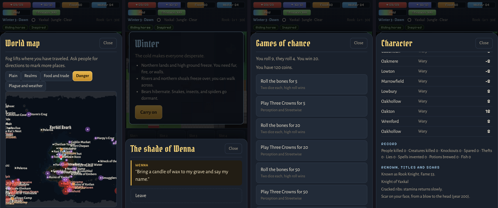</p>


- **Legendary beasts:** each continent has named monsters, such as Ashmaw the wolf or Old Belly the boar, that kill herders, grow stronger every year they live, and show up in rumors. Locals can tell you where one was last seen. Kill one and you keep its hide.
- **Animals remember you.** Hunt a pack's kin and the survivors in that country hunt you back. Feed a species and it leaves you be.
- **Fame** follows your deeds. Strangers greet you by name, admirers bring gifts, challengers come to town to test you in a duel, and you earn epithets such as Beastslayer, Hordebane, Peacemaker or the Whisperer.
- **Songs:** inn singers make verses from what really happened, including your deeds. You can also perform for tips.
- **The restless dead:** people who died badly haunt their villages at night until you put their story right, whether that's a candle at a grave, a message to their family, or justice for their killer.
- **Dreams and omens:** sleeping can reveal prophecies or the road to a sub-king, though killers dream of their victims. Omens such as two-headed calves, red rain and forked comets appear before a prophecy comes true.

## Coin, crime and comforts

- **Commissions:** order a weapon or armor from a smith, pay half, and collect it days later with your name on it.
- **Each nation mints its own coin.** Foreign coin costs a little extra; money-changers swap it for a fee. The Horde pays in scrip that only fences and Horde vassals will take.
- **Black markets** in back rooms: fence goods, sell scrip, and buy poison, bombs, lockpicks and forged papers.
- **Gambling:** roll the bones or play Three Crowns at inns. You can cheat, if you dare.
- **Food spoils.** Raw meat and fish go off within days; salt and winter cold keep them longer. Eating spoiled food can make you sick.
- **Informants** in foreign courts send reports and secrets. **Contracts:** the underworld pays you to kill named people, and if enough people hate you, someone pays an assassin to come after you.

## Hard times and honors

- **Moods:** people feel hunger, fear, plague, war and grief, and it shows in how they talk to you and how easily you persuade them. The bereaved drink at the tavern, and if you killed their spouse, they come for you.
- **Occupation:** towns the Horde captures keep a resistance. Kill the garrison, smuggle in weapons or pay for hiding places, then give the signal to rise.
- **Honors:** serve a crown to become Friend of the Crown, then Knight (a stipend and lower prices, but you must answer every call to war or lose the title), then Baron (no crown tax, a land grant, and a free settlement charter).
- **Winter passes:** mountain roads close in winter unless you brave the snow.
- **Wounds and scars:** big hits can concuss you or crack your ribs, and unbound wounds can fester into fever. Bad wounds leave scars; a scarred face impresses bandits more than nobles.
- **Companions grow and are mourned.** They level up from their own kills. When one dies, you mark the grave, the others grieve, and you can swear vengeance on the killer.
- **Map overlays** show realms and wars, food and trade, danger (Horde, lairs, legendary beasts, bounties), and plague and weather.

## Glory, gold and the road

<p align="center">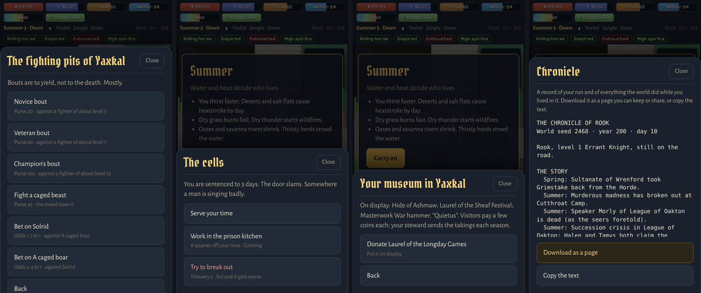</p>


- **Fighting pits** in towns: bouts to yield at three tiers, caged beasts, and wagers on other people's fights.
- **Outlaws** with names, crimes and prices on their heads roam the country. Read the wanted posters, then bring back the signet for the bounty, or knock them out and bind them for half again as much.
- **Your own caravans** buy cheap where they start and sell dear where they end, back and forth on their own, with as many guards as you pay for. Raiders can take them.
- **Sellsword companies** (the Grey Lanterns, the Ninefold Spears, the Salt Wolves and others) sell their swords in wars and switch sides when outbid. You can hire one to take a Horde fort or a bandit camp.
- **Named generals** lead each nation's armies, winning and losing on skill, morale and supply; armies far from home or fed by starving towns fight worse.
- **Battlefields stay.** The dead lie where they fell, scavengers come, and a necromancer may raise them to march on the nearest village.
- **Treasure maps to real hoards:** when a rival adventurer dies, their strongbox waits where they buried it. Innkeepers in their home town sell the map, and bandits sometimes carry one.
- **Hidden places and landmarks:** each continent has landmarks such as the Nine Stones or the Hanging Falls, and a few sites that are on nobody's map. Find them by exploring, or ask hunters and hermits.

## Crowns, cults and curses

- **Horde politics:** sub-kings scheme against each other for the Mad King's favor. Shame them by killing their troops or by spreading rumors through fences, and their own captains overthrow them; the Horde on that continent sends no warbands while the coup plays out.
- **Laws differ by nation:** curfews, peace-bonding heavy weapons, and bans on spellcasting in towns. Knights are exempt.
- **Prison:** a sentence is now a choice. Serve it, work in the kitchen to shorten it, try to break out, or have a friend or spouse pay your bail.
- **Secret cults** such as the Hollow Choir and the Children of the Ninth Bell grow in towns. People go missing and rituals summon beasts, the dead or plague. Gather clues, then accuse members until you reach the leader.
- **Holy water, blessings and curses:** bless water at an altar, anoint your gear so it bites the dead, and lift curses from cursed gear found in dungeons, which won't leave your hand. Wishing fountains in towns sometimes grant a wish, and sometimes curse you.
- **Bloodlines and clans:** vampires belong to the Velvet, Ashen or Mire Line, and werewolves to the Grey Moon, Silver Run or Stone Den clan, each with its own gifts. A shaman can teach you to choose when the beast comes out.

## Body and home

- **Addiction:** drink, dreamroot, madcap and mana tonics can hook you, and withdrawal brings shaking hands and pain. Healers and priests can help.
- **Sleep and spirits:** going too long without sleep makes you clumsy, then you start nodding off and seeing things. Good meals, companions, festivals and a comfortable bed lift your spirits; bad weather, loneliness and loss bring them down.
- **Ship crews** want wages and to see land now and then. Unhappy crews mutiny, and storms at sea batter the hull and wash sailors overboard.
- **Home life:** furnish your house for comfort, hire a housekeeper who cooks and keeps watch, and fit a lock, or burglars will visit while you're away.
- **A museum and collections:** found a museum and display trophies, relics and famous weapons for visitors' fees. Earn collector titles for species hunted, fish caught, landmarks found and exhibits shown.
- **Saves that survive updates,** and a **Chronicle** of your run you can download as a page or copy as text.

## Wild things

- **Animals grow up and grow old:** young, adult and old animals, with quirks such as *skittish*, *scarred* or *greedy* that ranch-bred stock passes on. Legendary beasts have names.
- **Signs in the wild:** kill sites, dung and territory marks show what lives nearby and how fresh the sign is. Predators hold territories, other animals keep clear, and birds and herds raise alarm calls when something big is coming.
- **Nests in spring,** with eggs to gather, if the parents let you. Night hunters own the forest after dark.
- **Herd sickness** (mange, hoof rot, frothing) spreads through ranches and wild herds. Isolate sick animals or lose the lot.
- **Fish stocks** in each lake and river: overfish one and it empties for seasons. Overhunting a region tips it into collapse.
- **Wild mounts must be broken,** three rides won before they accept you. Animal races with betting. Beast-speech, taught by hermits and shamans, calms animals. Blows can lame a leg or break a jaw instead of killing.

## Work and trade

- **Visible work:** farmers in the fields, smiths at the forge, and output that falls when workers die.
- **Building projects** you can donate to, **market days** with extra stock and better prices, and **regional goods** (amber, jade, dye, spice, seal oil, blue salt) that are cheap at home and dear far away.
- **Invest** in a town and draw a share each season. Expose **price rings**, or take a cut. Remote villages **barter**.
- **Wage work and apprenticeships.** Ore veins and woods run out. **Embargoes** make smugglers of honest caravans. Each culture has its own **dishes**. Wells become feuds in droughts. **Tolls** on the roads, armies that **forage** the countryside, and **named caravans** that become famous.

## People and society

- **Karma and gossip:** towns remember what you did, and people retell your deeds, bigger each time. Tell tall tales and you may get caught out.
- **Languages:** learn Horde speech, the old script or thieves' cant. Fluent enough, you can read captured Horde orders.
- **Children inherit** gifts and values, and an heir starts with the family talent.
- **Crime and investigations:** townsfolk commit crimes, and you can solve the cases. Your own unwitnessed killings can still be traced back to you.
- **Weddings, funerals and namings** gather the town in the plaza. Local clothes help with locals. Freed captives resettle, careers change, masters teach secret techniques, taverns brawl, beggars beg, grief takes different paths, pilgrims walk the roads, and people keep diaries.

## War and honour

- **Factions with opinions** of each other and of you. Low Horde morale, or proof of the Mad King's lies, sets vassals rising.
- **Conscription,** decaying bounties, **bounty hunters** and pardons. Raise your own **warband** and pay its wages. Take a fort, raise your banner, stock it, and hold it against counter-attacks.
- **Propaganda** that bards can answer, **hostages and ransoms** exchanged at peace, militias, signal fires, **blockades** that close ferries, and **sappers** you can counter-mine.
- **Heraldry:** every nation and noble house has a blazon and a painted shield, and so can you. Wars keep chronicles.

## Lore and magic

- **A real calendar** (Greening, Highsun, Leaffall, Deepcold) with named days, and anniversaries of history that folk still mark.
- **Ruins to study and dig:** carvings that tell old history, lost precursor knowledge (an ever-burning lamp, a dew-still, a sun-glass lens), and archaeology layer by layer down to a buried artifact.
- **Maps** bought from scholars (some of them wrong), ancient maps, and charts you draw yourself with the new **Cartography** skill.
- **A bestiary** that fills in as you see, kill and butcher creatures. **Graveyards** with epitaphs. **Lost heirs** to fallen crowns. **Artifacts that wander:** five named relics per world change hands between adventurers, some of them sentient with opinions of you. Weapons that kill enough wake up.
- **The Mad King's story** differs in every world. Commission your **biography**, and towns raise **statues** to you.
- **Faith:** forsake one god for another (the old one won't forget), climb the temple ranks, carry relics on holy errands, and bargain with powers on new moons.
- **Enchanting** for coin from the Circle of the Lantern. **Spell research** at a spellforge discovers Veil, Mend Flesh and Earthshake. **Ley lines** (with a map layer) make magic easier, and too much magic in one place draws things out of the air.
- **Corruption** from crystal and ash lands changes your body. **Covens** of witches bring rain, curse rivals and sell brewing secrets. **Fey courts** appear on full moons in the woods and steal children. **Strange skies:** auroras, blood rain and ether winds. NPCs drink potions mid-fight, and you can collect and play **creature cards**.

## Survival

- **Heavy armour** hurts lockpicking and hearing. **Clothing layers** under your armour keep you warm, but wet layers freeze until you dry them by a fire.
- **Frostbite takes fingers, toes or a nose,** and artificers fit brass fingers, a sprung foot or a silver nose.
- **Diet:** go without fruit and you get scurvy; with no fish or salt, goitre; eat widely and you are hardier. **Grime and lice** build up in cities and ships, so wash in rivers or pay for a hot bath.
- **The land changes:** rivers flood their banks, snow piles up (snowshoes and skis help), ice breaks underfoot in spring, volcanic lands quake and erupt, and tides open tidepools twice a day.
- **Fire-making is a skill** that rain and wind fight. Leave **snares** out overnight, build **fish weirs**, cure hides into leather and sew your own coat.
- **Foraging follows the seasons,** down to bark in a hungry winter. **Mountain sickness** at altitude. The smell of blood and smoke **draws predators** at night. Eating raw from a carcass may fill you, change you, or give you gut worms.
- **You grow old:** slower and wiser every decade.

## Life and travel

- **A home port** where your ships are kept up, **ship parts** (hull, sails, ram, figurehead), harbour pilots and lighthouses for night sailing, and **getting lost at sea** without stars or a compass.
- **Dive on wrecks,** raft rivers down to the sea, take **deep passages** between caves, and **climb** cliffs and town walls.
- **Dungeons have ecology:** everything inside is there for a reason. Places you discover give you their **legends**, and a **journal of moments** pins your greatest deeds on a map. The world map shows the trail you have walked and places you have only heard of.
- **Roads overgrow** when towns die. **Burn bridges** to turn armies back. Give **companions** orders and gear.
- **Fishing contests and harvest fairs.** **Your past catches up with you:** an old enemy, a lost sibling or an old mentor, depending on your background.
- **Smugglers' coves** and contraband runs, **hot springs and geysers**, and **retirement** on your own terms.

## The engine underneath

- **Bigger worlds:** *Vast* is now the default, and a new *Titanic* scale is six times *Standard*.
- **Off-screen battles keep their dead,** with named casualties and veterans who remember where they fought. **Townsfolk weigh their needs** (food, company, faith, coin and safety) and you can see what each person is doing.
- **Corpses become bones,** and food left out rots. A **region stats** layer on the map shows prosperity, Horde control and faith. At the end, **watch the world's history** as a time-lapse.
- **Scenario starts:** a besieged town, a shipwreck, or an escape from a Horde camp. **Simulation sliders** for army speed, winters and hunger.
- **Demo tools:** a **god view** to watch the world without you, and an **autoplay bot** that plays thousands of turns and reports errors and stuck states. A **frame budget** precomputes when the browser is idle and drops decorative overlays on slow devices.
- **A new look:** legible meters, a compact phone HUD, a colour-coded log, a framed map, soft fog edges, and long dialogue lists grouped into sections.

## Mods

The game supports **JSON mods** for new creatures, items, spells, starting kits, recipes, wildlife, rumors, and simple events. Install them from **Menu → Mods.** See [docs/MODDING.md](docs/MODDING.md) and the example [Marsh Folk](docs/mods/marsh-folk.json) mod.

## Seasons, days, and moons

<p align="center"></p>

- **Days:** a full day is 360 turns long and a season lasts 6 days. Snow buries fields, rivers freeze into roads, and armies stay home in winter.
- **The moon** follows an 8-day cycle:
  - Full moons bring out wolves and werewolves.
  - New moons are pitch black, when thieves and vampires hunt.
  - Blood moons raise the dead.
  - Rare eclipses darken midday.

<p align="center"></p>

## Body, sickness, and strange fates

- **Survival:** manage hunger, thirst, temperature, swimming, and drowning.
- **23 diseases**, including Black Boil, Lockjaw, Rabies, Lung-rot, Brain Fever, Crystal Blight, and the Grey Walk:
  - Each spreads its own way: bites, water, air, wounds, or contact.
  - Each has silent incubation, visible symptoms, and a cure. Healers can diagnose you.
- **Vampirism:** you get night vision and strength, but you must feed on sleeping people and burn in daylight. Vampire nobles keep thralls, and an infected victim can spread the curse. It is curable.
- **Solar cyborg augments:** an artificer in a precursor vault can install arms, legs, eyes, skin, a core, an arm cannon, a neural lace, or a cloak. They make you far stronger, but they run on sunlight.

## Alchemy

All 26 reagents carry four hidden properties out of 24, reshuffled in every world, much like Skyrim and NetHack's unidentified potions:
- Taste reagents to learn their properties.
- Brew two or three together, and the properties they share become the potion.
- Found potions are unidentified. Drink them, throw them, coat a weapon, mix two (carefully), or pay a healer to identify them.

<p align="center">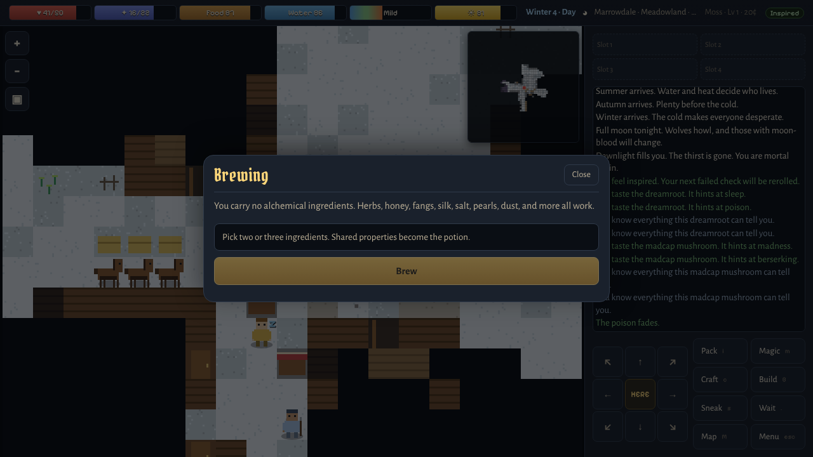 </p>

## Tabletop at heart

- **d20 checks:** risky actions roll a d20 against a difficulty and show the roll in your log. Heroic moments grant inspiration, which rerolls your next failure.
- **Reactions and morale:** creatures roll 2d6 to react when they first meet you. Wounded and leaderless enemies may break and flee, or surrender.
- **Backgrounds:** soldier, noble, outlander, sailor, acolyte, criminal, sage, folk hero, or hermit, on top of 9 classes.

## Also in the box

- 170 creature and NPC types, 154 items, 59 recipes, 10 mounts, and 24 vehicles.
- Morrowind-style spell invention: combine up to 4 of 27 effects.
- Enchanted forging, farming, building shelters, and buying an empty house in any village.
- Hiring sellswords, taming pets, and procedural pixel art throughout.
- **Procedural music and sound.** All audio is synthesized live with the Web Audio API, so no audio files ship with the game and everything is copyright-free by construction.
  - The music shifts by biome, time of day, danger, town, and moon phase.
  - Sound effects respond to steps, hits, gunfire, explosions, splashes, spells, coins, howls, and thunder.

<p align="center">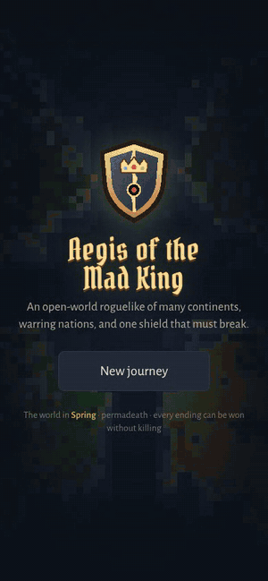 </p>

▶️ **Full recorded playthrough:** [docs/media/playthrough.mp4](docs/media/playthrough.mp4). Playtest notes and known issues are in [docs/PLAYTEST.md](docs/PLAYTEST.md).

## Develop

The game is plain JavaScript with no dependencies, in `src/00_core.js` through `src/18_ui.js`, plus the `head.html` shell. `./build.sh` bundles everything into the single-file `index.html`.

```bash
./build.sh                      # rebuild index.html
node tests/smoke.js seed1,seed2 # browser fuzz test (requires playwright)
node tests/bot.js 4000 1,2,3 vast # autoplay bot: errors, stuck states, save/load
```

The original hackathon version (one continent, three shards) lives in [`classic/`](classic/).

## Inspirations and credits

This is an original game, written from scratch. It borrows ideas, not code or assets, from:
- **Roguelikes:** Shattered Pixel Dungeon (creature states, clean mobile UI), NetHack (unidentified potions, emergent interactions), and Pathos.
- **Survival and simulation:** Cataclysm: DDA (noise, survival), Dwarf Fortress (generated history and legends), UnReal World (wind, scent, hunting), Caves of Qud (village lore, factions), and Rain World (off-screen creature simulation).
- **Tabletop:** D&D, from the d20 checks and inspiration of the 5e SRD, and OSR games, from 2d6 reactions and morale.

Note that Dwarf Fortress itself is closed source; its community tools DFHack and df-structures are open.

- **Fonts:** Pirata One, Alegreya Sans, and Pixelify Sans, under the SIL Open Font License, bundled in `fonts/`.
- **Art and audio:** all generated procedurally in code.
